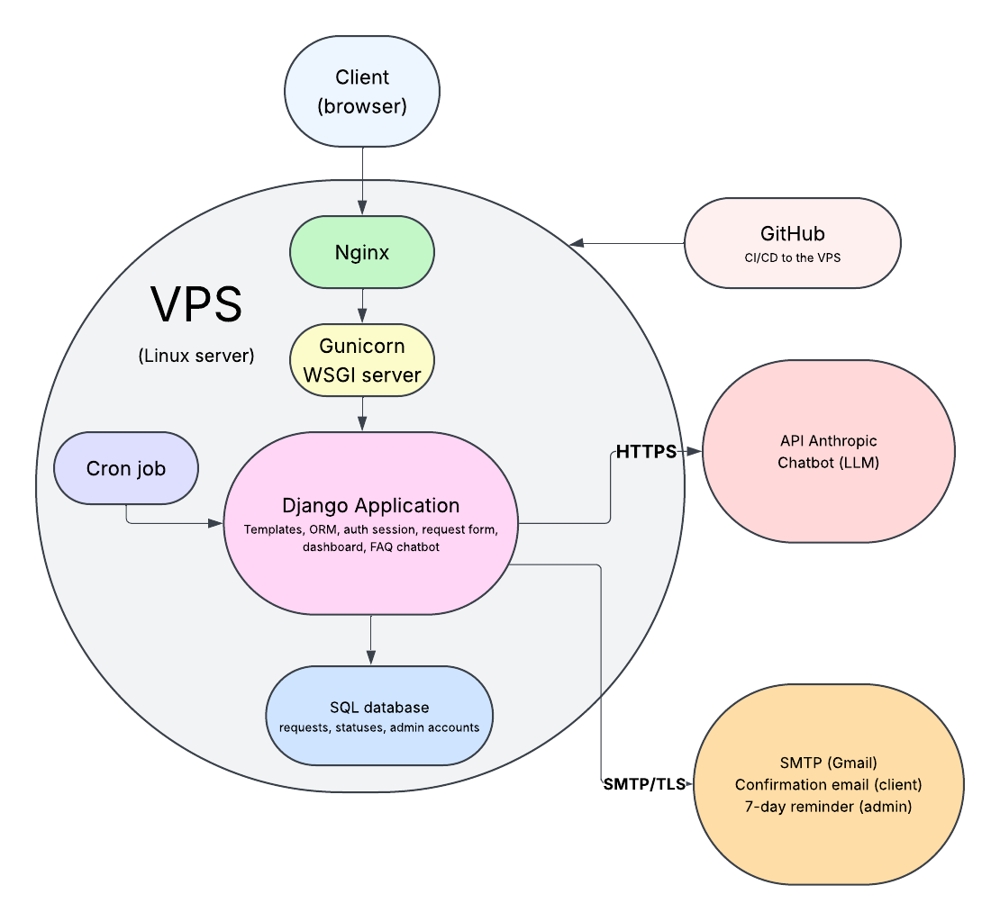
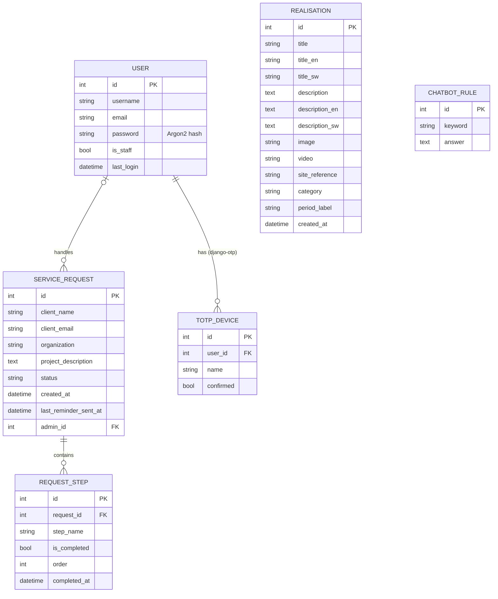

# Restituo

3D archaeological restitution site and client request management platform,
hosted at [sagalhaider.com](https://sagalhaider.com).

Visitors browse 3D restitutions of archaeological sites and historic cities,
ask questions to a chatbot, and submit a project request. The administrator
follows each request from a dashboard protected by two-factor authentication.

## Features

- Public gallery of 3D restitutions (images and videos), in French, English and Swahili
- Public request form with confirmation email
- Chatbot: FAQ rules first, LLM fallback (Anthropic API) when no rule matches
- Admin dashboard: list and filter requests, check project steps, progress per request
- Automatic reminder to the administrator when a request stays unanswered for 7 days

## Tech stack

| Area | Choice |
| --- | --- |
| Backend | Django 5.2 |
| Database | SQLite, via the Django ORM |
| Rate limiting | Redis (optional locally) |
| Frontend | Django templates, vanilla JavaScript, CSS |
| Chatbot | FAQ rules with an LLM fallback (Anthropic API) |
| Authentication | Django sessions, 2FA (TOTP) with django-otp, Argon2 hashing |
| Emails | SMTP over TLS |
| Server | Nginx, Gunicorn, Linux VPS |
| Tests | pytest-django |
| CI | GitHub Actions |

## Architecture



1. The browser sends a request to **Nginx**, which handles HTTPS and serves static files.
2. Nginx forwards dynamic requests to **Gunicorn**, which runs the **Django** application.
3. Django reads and writes data in the **SQLite** database through the ORM.
4. Django calls external services: the **Anthropic API** for the chatbot fallback (HTTPS), and an **SMTP** server for emails (TLS).
5. A **cron job** runs the `send_reminders` command every morning.
6. **GitHub Actions** lints and tests every push, then deploys to the VPS.

### Project structure

| App | Role |
| --- | --- |
| `config` | Settings (secrets read from `.env`, security settings), root URLs |
| `core` | Public pages, rate limiting helper (`is_rate_limited`) |
| `accounts` | Login with password and 2FA code |
| `servicerequests` | Request and step models, public form, admin dashboard API, `send_reminders` command |
| `chatbot` | FAQ rules, chatbot endpoint, `ChatbotService` (FAQ then LLM) |
| `realisations` | Gallery content (images, videos, translations) |

## Database



- A **user** (administrator) handles zero or many **service requests**. A request may have no assigned administrator yet (`admin` is nullable, `on_delete=SET_NULL`: deleting the user keeps the request).
- A **service request** contains zero or many **steps**; deleting a request deletes its steps.
- `Realisation` and `ChatbotRule` are independent content tables, managed from the Django admin.

## Security

- Two-factor authentication (TOTP) on the Django admin and on the dashboard and its API
- Passwords hashed with Argon2 (PBKDF2 kept as fallback for old hashes)
- Brute force protection on login with django-axes
- Rate limiting with Redis on the form, the chatbot and the login
- Honeypot field against bots on the public form
- Client data escaped before display in the dashboard (XSS)
- CSRF protection on admin actions, token sent in the `X-CSRFToken` header
- HTTPS enforced: HSTS, SSL redirect, secure cookies
- Real MIME type check on uploaded videos
- Security logging (failed logins, server errors)
- Secrets in `.env`, never committed

## Requirements

- Python 3.11+
- Redis (optional, see below)

## Installation

```bash
git clone https://github.com/sagalou/sagalhaider-com.git
cd sagalhaider-com
python3 -m venv venv
source venv/bin/activate
pip install -r requirements.txt
cp .env.example .env
```

Edit `.env` if needed (Anthropic API key, SMTP credentials). By default:

- SQLite is used as the database
- `REDIS_DISABLED=1`: rate limiting uses local memory, no Redis server needed
- emails are printed to the terminal

## Run the project

```bash
python manage.py migrate
python manage.py createsuperuser
python manage.py loaddata initial_realisations initial_rules
python manage.py runserver
```

- Site: http://127.0.0.1:8000
- Django admin: http://127.0.0.1:8000/django-admin/
- Dashboard login: http://127.0.0.1:8000/login

## Run the tests

```bash
REDIS_DISABLED=1 pytest -v
```

40 tests cover login and 2FA, the request form, the dashboard API, the chatbot and the public pages. See [docs/testing.md](docs/testing.md).

## With Redis (optional)

```bash
docker run -p 6379:6379 redis:7-alpine
```

Then set `REDIS_DISABLED=0` in `.env`.

## Project documentation

- [Sprint planning](docs/sprint-planning.md)
- [Sprint reviews](docs/sprint-reviews.md)
- [Retrospectives](docs/retrospectives.md)
- [Testing](docs/testing.md)
- [Bug tracking](https://github.com/sagalou/sagalhaider-com/issues?q=is%3Aissue+label%3Abug)

## Author

Sagal-Louise Haider ([@sagalou](https://github.com/sagalou))